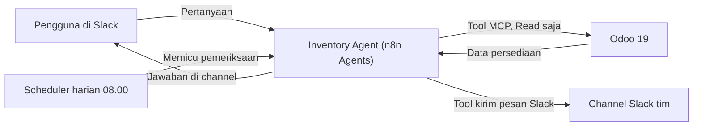

# How I Built an Inventory Agent with n8n, Slack, and Odoo: AI Agent that checks Odoo inventory and sends daily stock risk reminders to Slack

Agentic AI yang membaca data persediaan langsung dari Odoo 19, menjawab pertanyaan lewat Slack dalam bahasa Indonesia, dan mengirim pengingat risiko stok otomatis setiap hari pukul 08.00 pagi.

Proyek ini dibuat untuk keperluan portfolio dan berjalan di atas data sintetis distributor produk kesehatan. PT KAMIL SEJAHTERA yang muncul di dokumentasi ini hanya perusahaan demo, bukan perusahaan sungguhan.

## Problem

Salah satu masalah dalam Supply Chain Management adalah pengelolaan inventory. Stok harus cukup untuk memenuhi pesanan pelanggan, tetapi tidak boleh berlebih sampai menahan modal. Ambil contoh distributor produk kesehatan: stoknya punya masa kedaluwarsa, permintaannya naik turun dari bulan ke bulan, dan setiap pemasok punya lead time sendiri. Kerugian persediaan jarang datang dari satu kejadian besar. Ia menumpuk pelan-pelan lewat lot yang melewati tanggal kedaluwarsa, barang laris yang habis sebelum pasokan tiba, stok lambat yang menahan modal, dan selisih stok yang penyebabnya tidak jelas.

Datanya sudah ada di Odoo, tetapi tersebar di beberapa menu. Untuk menjawab pertanyaan seperti "apa yang harus ditangani hari ini?", seseorang harus membuka banyak menu, mencocokkan angkanya sendiri, lalu menilai urgensinya. Reorder rule bawaan Odoo bersifat statis dan tidak melihat tren penjualan, lead time aktual, atau risiko kedaluwarsa. Pengecekan semacam ini juga baru terjadi kalau ada yang ingat melakukannya.

## Solution

Inventory Agent dibangun dengan fitur Agents di n8n. Agent mengambil data dari Odoo 19 lewat MCP Server, lalu berinteraksi dengan tim melalui Slack dengan dua cara: menjawab pertanyaan, dan mengirim reminder terjadwal.

Odoo menjadi satu-satunya sumber data, jadi tidak ada database tambahan yang perlu disinkronkan. Akses Agent ke Odoo sengaja dibatasi hanya pada Read. MCP Server tidak diberi izin Write atau Update karena kebutuhan Agent ini memang sebatas membaca dan menganalisis data.

## Arsitektur

## Komponen

| Komponen | Peran |
| --- | --- |
| Odoo 19 | Sumber data persediaan, penjualan, dan pembelian |
| MCP Server (add-on Odoo) | Jembatan agar Agent bisa membaca data Odoo, dengan izin Read saja |
| n8n Agents | Menjalankan Agent dengan model, instruksi, dan tools |
| Channel Slack | Tempat pengguna bertanya kepada Agent |
| Tool kirim pesan Slack | Dipakai Agent untuk mengirim reminder ke channel |
| Schedule | Memicu Agent setiap hari pukul 08.00 pagi |

## Standar prioritas

Setiap temuan diberi tingkat prioritas dengan aturan eksplisit di instruksi Agent.

| Tingkat | Arti | Mulai ditangani |
| --- | --- | --- |
| P1 Kritis | Contoh: lot melewati atau mendekati removal date dalam 2 hari | Hari ini |
| P2 Tinggi | Contoh: stock cover sama dengan atau lebih pendek dari lead time pemasok ditambah buffer 2 hari | Maksimal 1 hari kerja |
| P3 Menengah | Contoh: selisih stok negatif yang penyebabnya belum diketahui | Maksimal 3 hari kerja |
| P4 Rendah | Contoh: scrap yang sudah dibukukan tanpa indikasi berulang | Maksimal 7 hari kerja |

Stock cover dihitung dari stok layak jual yang belum teralokasi dibagi rata-rata permintaan harian selama 28 hari. Setiap temuan juga diberi label Terverifikasi, Estimasi, atau Perlu verifikasi.

## Reminder otomatis

Setiap hari pukul 08.00 pagi, schedule menjalankan tugas berikut:

> Periksa risiko persediaan terbaru untuk PT KAMIL SEJAHTERA. Gunakan standar prioritas yang sudah ditetapkan. Tampilkan maksimal 5 temuan P1 dan P2, pertimbangkan tren penjualan serta kondisi pemasok, lalu berikan tindakan pertama yang disarankan. Kelompokkan temuan berdasarkan tingkat prioritas, dan sebutkan apakah tren penjualan produk tersebut naik, relatif datar, atau turun. Jangan mengubah data Odoo. Jika tidak ada P1/P2, cukup sampaikan bahwa tidak ditemukan risiko prioritas tinggi.

Reminder hanya membahas P1 dan P2 agar channel tidak dibanjiri temuan yang belum mendesak. Schedule hanya menjalankan versi published dari Agent.

## Batasan

- Akses ke Odoo sengaja dibatasi pada Read. Agent tidak memiliki izin Write atau Update, sesuai kebutuhannya yang berfokus pada analisis.
- Memory memakai pengaturan default n8n: session memory aktif, cross-session memory dimatikan.
- Fitur Agents n8n berstatus Preview menurut dokumentasi resminya, sehingga perilakunya bisa berubah.
- Data bersifat sintetis, jadi dampak bisnisnya belum diukur dalam angka nyata.

## Dampak

Menelusuri beberapa menu Odoo lalu mencocokkan datanya secara manual kini cukup diganti satu pertanyaan di Slack. Jawabannya berisi 3 sampai 5 temuan terpenting, berurutan menurut prioritas, lengkap dengan produk, kuantitas, dokumen sumber, aturan pemicu, dan tindakan pertama. Pemeriksaan juga tidak lagi bergantung pada ada tidaknya orang yang ingat untuk mengecek.

## Penutup

Odoo tetap menjadi sumber data utama dan keputusan akhir tetap di tangan manusia. Agent hanya mengumpulkan data dan mengurutkan apa yang perlu didahulukan. Video demo dengan alur lengkapnya dilampirkan terpisah.

## Referensi

Dokumentasi resmi n8n: [Build and manage Agents](https://docs.n8n.io/build/build-and-manage-Agents)

## Medium Article
https://medium.com/@ahmadkamiludin/how-i-built-an-inventory-Agent-with-n8n-slack-and-odoo-ai-Agent-that-checks-odoo-inventory-and-bc62abb286e9?sharedUserId=ahmadkamiludin

## Demo Video

https://youtu.be/bzhat-xnBms

Thank You...